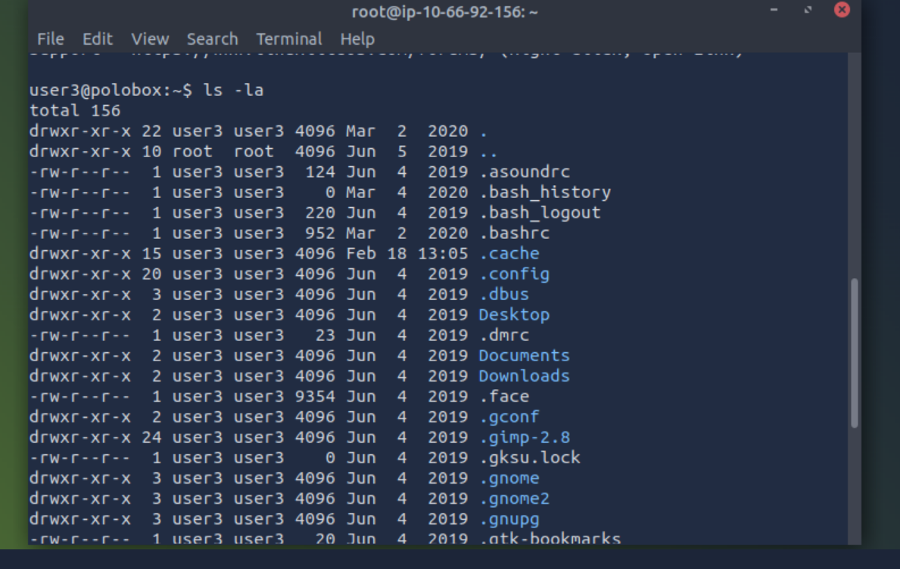
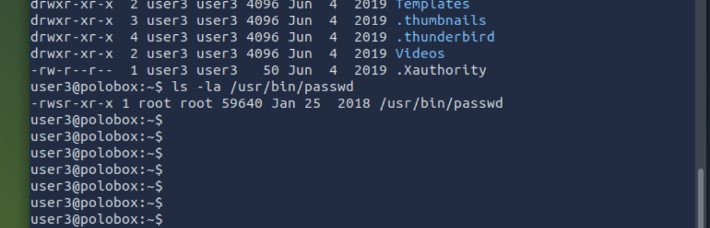
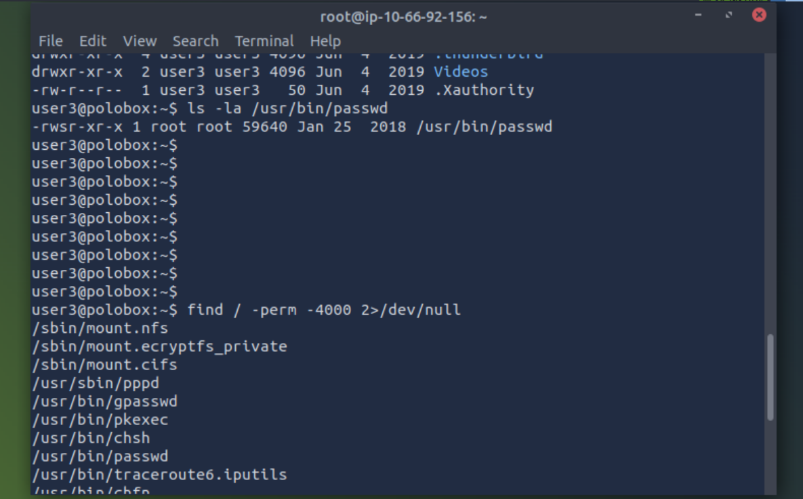
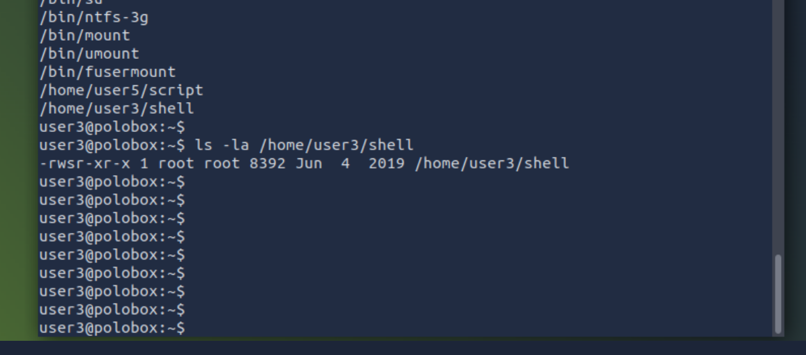

# Linux: анализ прав доступа и SUID

Практика в учебной среде: чтение владельца и групп прав, проверка системной программы `passwd`, поиск файлов с SUID и разбор отдельного учебного бинарного файла.

## Что проверялось

- `ls -la`: тип файла, владелец, группа и права.
- `ls -la /usr/bin/passwd`: пример системного исполняемого файла с SUID.
- `find / -perm -4000 2>/dev/null`: перечень объектов с установленным SUID.
- `ls -la /home/user3/shell`: права конкретного файла в учебной среде.

Скриншоты ниже подтверждают просмотр прав и результаты поиска. Сам список SUID-файлов не доказывает получение повышенных привилегий. Для оценки риска нужно отдельно анализировать программу, её владельца и доступность записи.

[Краткая справка: права, SUID, SGID и sticky bit](file-permissions.md)

## Артефакты

## Basic permissions overview

Command:

    ls -la

---

## System SUID example

Command:

    ls -la /usr/bin/passwd

---

## SUID enumeration

Command:

    find / -perm -4000 2>/dev/null

---

## User SUID binary example

Command:

    ls -la /home/user3/shell

